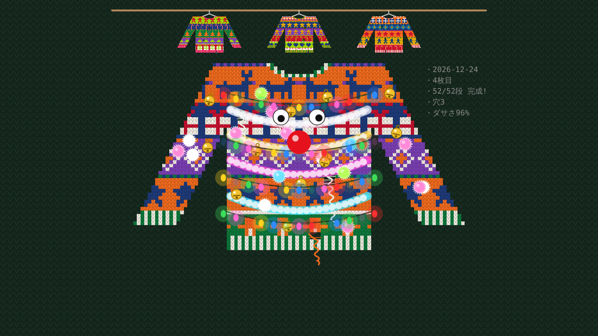

# Ugly Christmas Sweater

A completely unnecessary Claude Code desktop theme that converts your token consumption into increasingly ugly Christmas sweaters.

**You write the code. Claude knits the consequences.**



## What it does

A sweater is knitted behind your chat in pixel stitches, top-down, while you work.

- **One tool call, one row.** A band's motif follows the tool that started it, and every band is mirrored left to right:

  | Tool | Motif |
  | --- | --- |
  | Bash | zigzag |
  | Read | snowflake |
  | Edit | tree |
  | Write | gift |
  | Grep | reindeer |
  | Glob | diamond |
  | WebSearch | star |
  | WebFetch | bell |
  | Agent | gingerbread man |
  | Skill | heart |
  | MCP tools | candy cane |

- **The fuller the context window, the tackier it gets.** Pom-poms from 8%, jingle bells from 20%, tinsel from 35%, blinking fairy lights from 55%. Past 80% the sweater grows googly eyes and a red nose and looks back at you.
- **Errors drop stitches.** A failed tool call leaves a hole, a ladder under it and a loose end of yarn.
- **`/compact` shakes the trimmings off.** So does `/clear`. They come back as the context fills again.
- **52 rows make a sweater.** A finished one goes up on a hanger along a rail at the top (the last four; older ones are folded onto a pile) and the next is cast on.
- **A new day, a new sweater.** At midnight the rail is cleared and you start over.
- **`/sweater`** opens the sweater in a pane of its own.


## Install

At the prompt of a terminal session:

```
/plugin install ugly-christmas-sweater --marketplace TuesdayGhost/UGLY-CHRISTMAS-SWEATER
```

From a shell:

```
claude plugin install ugly-christmas-sweater --marketplace TuesdayGhost/UGLY-CHRISTMAS-SWEATER
```

In the desktop app: click + next to the prompt box, then Plugins, Add marketplace with `TuesdayGhost/UGLY-CHRISTMAS-SWEATER`, then Add plugin.

The backdrop draws in the desktop and mobile apps. A terminal has no backdrop to draw on; the sweater is still knitted there, unseen.

## Options

`timeZone`: an IANA name such as `Asia/Tokyo`, for whose midnight starts a new sweater. Empty means the machine's own.

## 日本語

Claude Code デスクトップ用の、まったく必要のないテーマです。あなたのトークン消費を、だんだんダサくなっていくクリスマスセーターに変換します。

**コードを書くのはあなた。その報いを編むのはClaude。**

「アグリー・クリスマス・セーター」は、トナカイや雪の結晶をこれでもかと編み込んだ、わざとダサいセーターを着て集まる英語圏の年末の風習です。ダサければダサいほど良いとされています。

- ツールを1回呼ぶたびに1段編まれます。帯の模様はツールごとに違います（Bashはジグザグ、Readは雪の結晶、Grepはトナカイなど）。
- コンテキストが埋まるほど、ポンポン、鈴、モール、電飾が増えていきます。80%を超えると目玉と赤鼻が付いて、こちらを見てきます。
- ツールが失敗すると編み目が飛んで、穴が開き、毛糸が垂れます。
- `/compact` すると飾りが全部落ちます。
- 52段で1枚完成。完成品はハンガーに掛かって画面上部に並びます。
- 日付が変わると、新しいセーターを編み始めます。
- `/sweater` でセーターだけをペインに開けます。

世間がクリスマス一色のなか、自分はなぜダサいセーターを育てているのか。その問いに、このテーマは答えません。

## License

MIT
