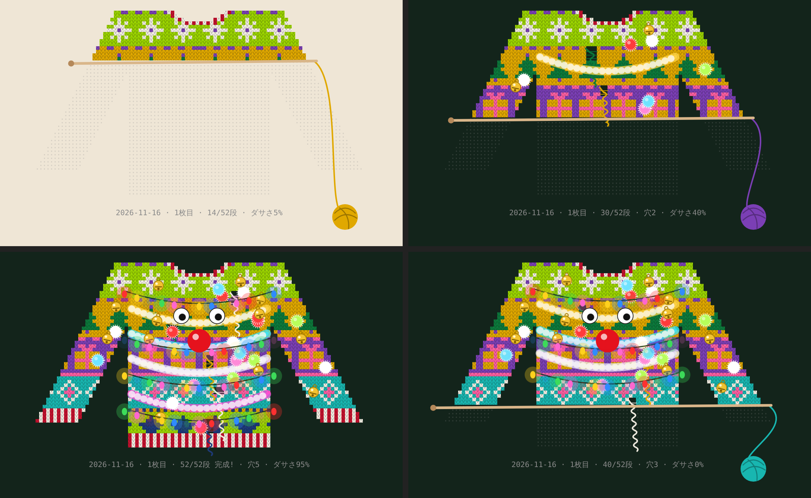

# Ugly Christmas Sweater

A Claude Code desktop theme mod that knits an ugly Christmas sweater behind the chat, in pixel stitches (one stitch is one cell).



- Every tool call knits one row. A band's motif follows the tool that started it: Bash zigzags, Read snowflakes, Edit trees, Write gifts, Grep reindeer, Glob diamonds, WebSearch stars, WebFetch bells, Agent gingerbread men, Skill hearts, MCP tools candy canes. Every band is mirrored left to right.
- The fuller the context window, the tackier it gets: pom-poms, jingle bells, tinsel, blinking fairy lights and, past 80%, googly eyes and a red nose.
- A failed tool call drops stitches: a hole, a ladder under it and a loose end of yarn.
- `/compact` (or `/clear`) shakes all the trimmings off.
- At midnight a new sweater is cast on. A finished sweater (52 rows) goes up on a hanger along a rail at the top (the last four; older ones are folded onto a pile) and the next one starts.
- `/sweater` opens the sweater in a pane of its own.

The `timeZone` option (an IANA name such as `Asia/Tokyo`) picks whose midnight counts; empty means the machine's own.

## Install

At the prompt of a terminal session:

```
/plugin install ugly-christmas-sweater --marketplace TuesdayGhost/UGLY-CHRISTMAS-SWEATER
```

From a shell:

```
claude plugin install ugly-christmas-sweater --marketplace TuesdayGhost/UGLY-CHRISTMAS-SWEATER
```

In the desktop app: click + next to the prompt box, then Plugins, Add marketplace with `TuesdayGhost/UGLY-CHRISTMAS-SWEATER`, then Add plugin.
